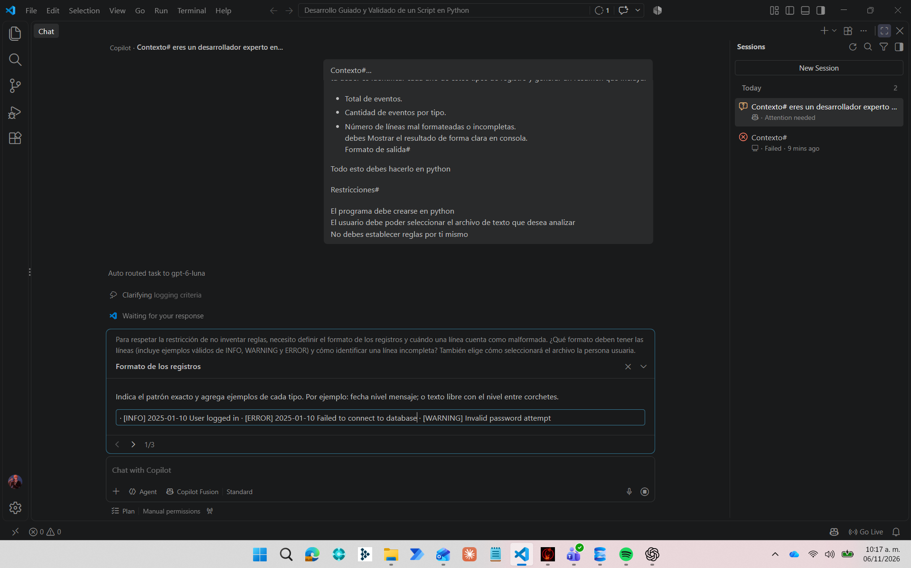
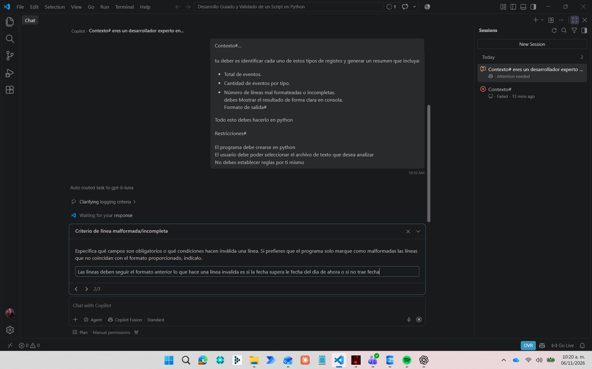
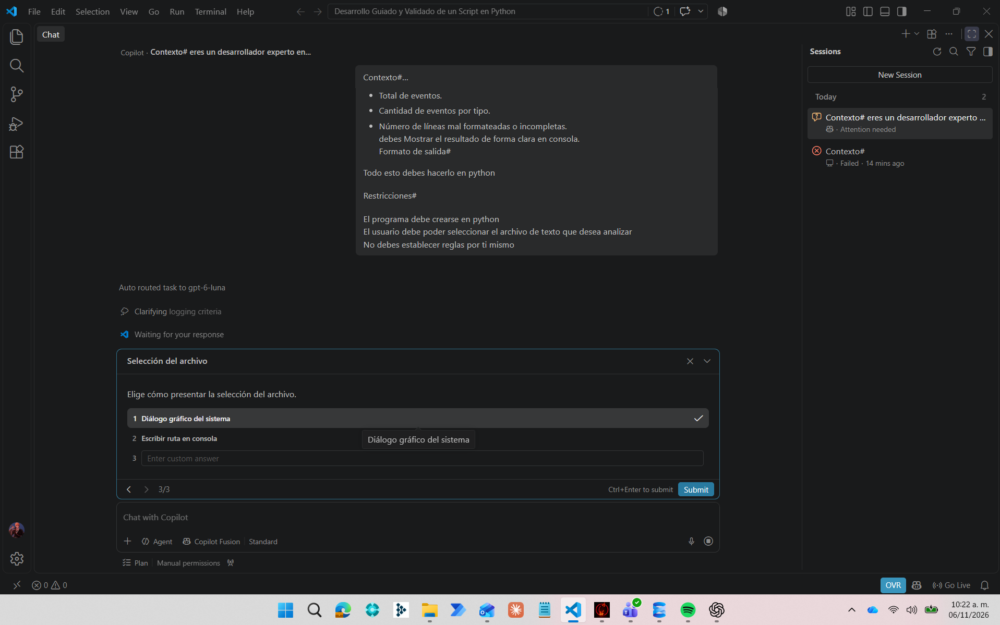
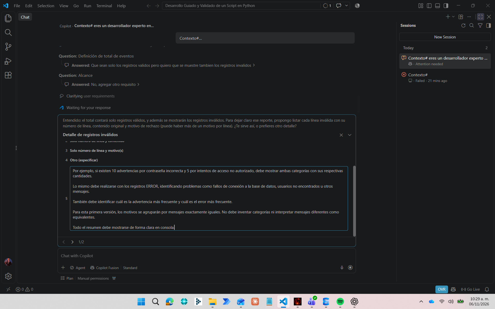
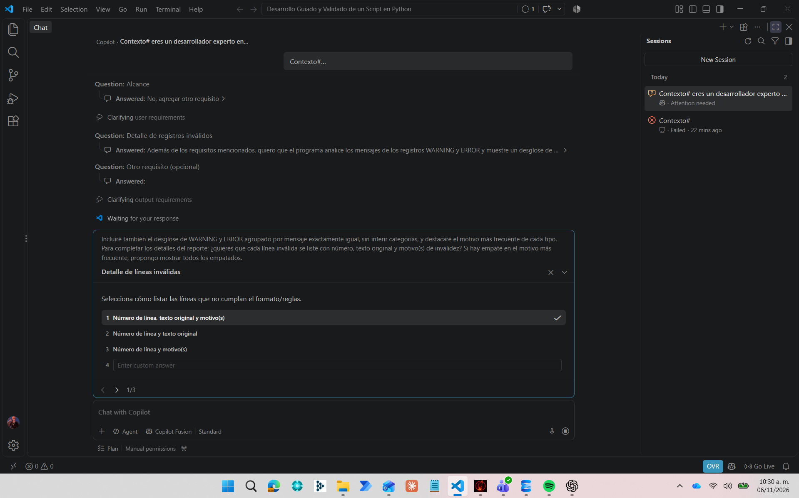
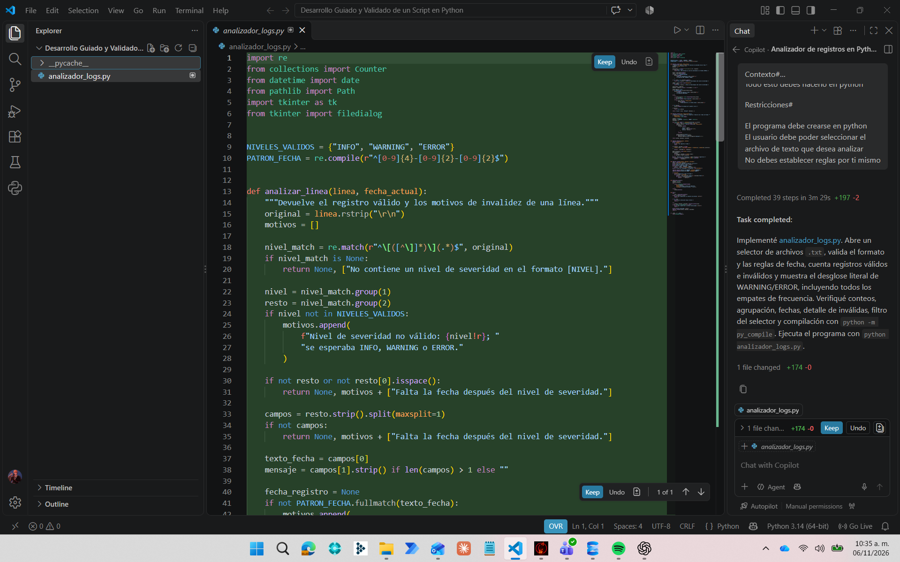
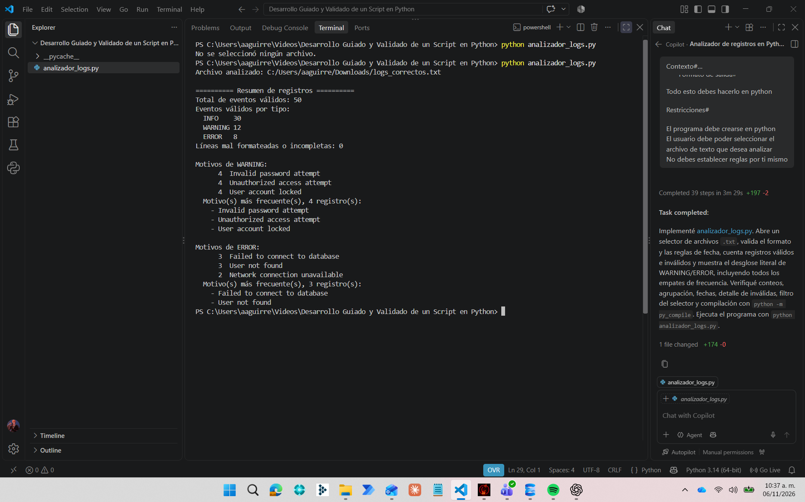
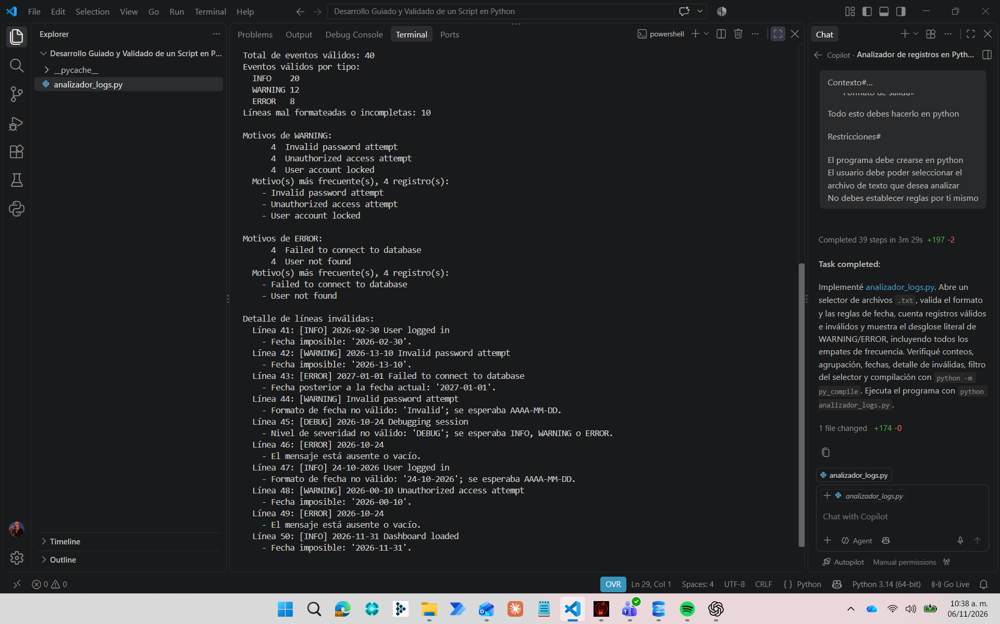

# Analizador de Logs en Python

## 1. Descripción del proyecto

Para este proyecto se solicitó desarrollar un programa capaz de analizar archivos de logs que contienen registros con tres niveles establecidos: INFO, WARNING y ERROR.

El programa debe leer los registros, verificar que cumplan con el formato establecido e identificar aquellos que presenten errores o inconsistencias.

Para desarrollar esta solución se utilizó Python, con apoyo de inteligencia artificial como herramienta de desarrollo.

## 2. Uso de inteligencia artificial

La primera parte de la actividad consistió en solicitar apoyo a GitHub Copilot mediante su extensión en Visual Studio Code. Se utilizó el modo Plan para establecer los requisitos y las reglas antes de comenzar la implementación.

### Prompt inicial

**Contexto**

Eres un desarrollador experto en Python y en análisis de datos.

**Instrucción**

Crea un programa que lea archivos de registros de log.

Existirán tres tipos de registro: INFO, WARNING y ERROR.

- INFO serían los que están correctos.
- WARNING serían errores de capa 8.
- ERROR serían errores asociados al programa.

Tu deber es identificar cada uno de estos tipos de registro y generar un resumen que incluya:

- Total de eventos.
- Cantidad de eventos por tipo.
- Número de líneas mal formateadas o incompletas.

Debes mostrar el resultado de forma clara en consola.

**Formato de salida**

Todo esto debes hacerlo en Python.

**Restricciones**

- El programa debe crearse en Python.
- El usuario debe poder seleccionar el archivo de texto que desea analizar.
- No debes establecer reglas por ti mismo.

## 3. Planificación y decisiones técnicas

A partir del prompt inicial, GitHub Copilot comenzó la planificación y solicitó aclaraciones sobre el formato de los registros, los criterios para identificar líneas inválidas y la forma de seleccionar los archivos.

Estas preguntas permitieron definir las reglas antes de comenzar la implementación, como se observa en las siguientes figuras.

Entre las decisiones tomadas se encuentran:

- Utilizar el formato `[NIVEL] AAAA-MM-DD mensaje`.
- Considerar válidos únicamente los niveles INFO, WARNING y ERROR.
- Rechazar registros con fechas inexistentes, incorrectas o posteriores a la fecha actual.
- Considerar inválidas las líneas que no contengan un mensaje.
- Contar únicamente los registros válidos en el resumen de eventos.
- Mostrar por separado la cantidad de registros inválidos.
- Permitir la selección del archivo mediante una ventana de Windows.

Posteriormente, se solicitó incorporar un desglose de los motivos de WARNING y ERROR, con el objetivo de identificar los problemas más frecuentes dentro de los registros.

Para presentar las líneas inválidas, Copilot propuso mostrar el número de línea, el contenido original y los motivos del rechazo. Esta recomendación fue evaluada y aceptada por considerarse útil para identificar las inconsistencias durante las pruebas.

## 4. Implementación del programa

Una vez creado y revisado el plan de desarrollo, se aprobó la implementación del programa utilizando la opción **Implement with Autopilot** de GitHub Copilot.

No se concedieron permisos completos desde el inicio, sino que se fueron autorizando las acciones de edición conforme eran solicitadas.

Al finalizar la implementación, se obtuvo un programa funcional capaz de analizar los archivos de logs y mostrar los resultados en consola.

## 5. Evidencia de pruebas

Para comprobar el funcionamiento del programa se utilizaron dos archivos de prueba, cada uno con 50 registros.

### Prueba 1: Archivo con buen formato

Se utilizó el archivo `logs correctos.txt`, que contenía registros con fechas válidas, niveles de severidad reconocidos y mensajes completos.

El programa identificó correctamente los registros y mostró los motivos más frecuentes de WARNING y ERROR, incluyendo los casos donde existían empates.

**Resultados:**

- Esperado: 50 registros válidos y 0 inválidos.
- Obtenido: 50 registros válidos y 0 inválidos.

**Evidencia:**

### Prueba 2: Archivo con formato inconsistente

Se utilizó el archivo `logs inconsistentes.txt`, que contenía registros correctos y otros con fechas inválidas, niveles desconocidos o mensajes incompletos.

El programa identificó correctamente las diez líneas inválidas y explicó los motivos por los cuales fueron rechazadas.

**Resultados:**

- Esperado: 40 registros válidos y 10 inválidos.
- Obtenido: 40 registros válidos y 10 inválidos.

**Evidencia:**

## 6. Identificación y mejora de una propuesta de IA

Durante la planificación, GitHub Copilot propuso inicialmente un alcance que contemplaba los conteos por severidad, la identificación de registros inválidos y la selección de archivos.

Sin embargo, se identificó que esta propuesta no incluía el desglose de los motivos más frecuentes de WARNING y ERROR, una funcionalidad que se consideraba importante para comprender mejor los problemas registrados.

Por esta razón, se solicitó modificar el alcance para incluir la agrupación de mensajes idénticos y la identificación de las advertencias y errores más frecuentes.

Copilot incorporó esta modificación y posteriormente se comprobó su funcionamiento mediante los archivos de prueba.

Este caso demuestra cómo una propuesta de inteligencia artificial puede ser revisada y mejorada mediante decisiones humanas antes de su implementación.

## 7. Reflexión final

Durante el desarrollo de esta solución considero que la IA es una herramienta bastante útil para aumentar la agilidad en la creación de programas. Sin embargo, también aprendí que es necesario establecer parámetros claros, ya que, a pesar de tratarse de un programa relativamente sencillo, fue necesario definir reglas y validaciones para asegurar su correcto funcionamiento.

También comprendí que no debemos aceptar automáticamente todas las soluciones propuestas por la IA, porque algunas pueden ser correctas, mientras que otras pueden estar incompletas o necesitar mejoras.

En conclusión, considero que la IA puede facilitar mucho el desarrollo de software, pero las decisiones sobre el funcionamiento del programa y la validación de los resultados deben seguir siendo responsabilidad del desarrollador.